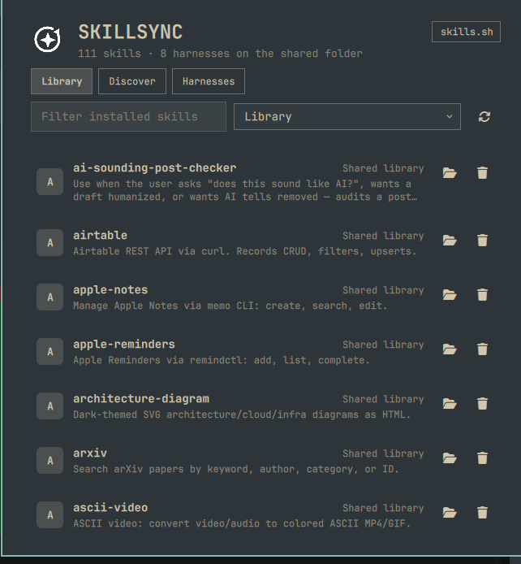
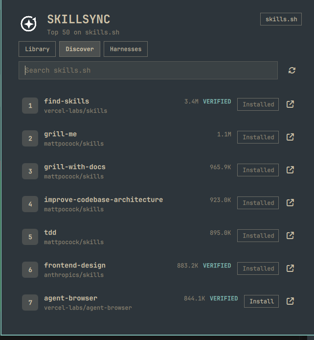
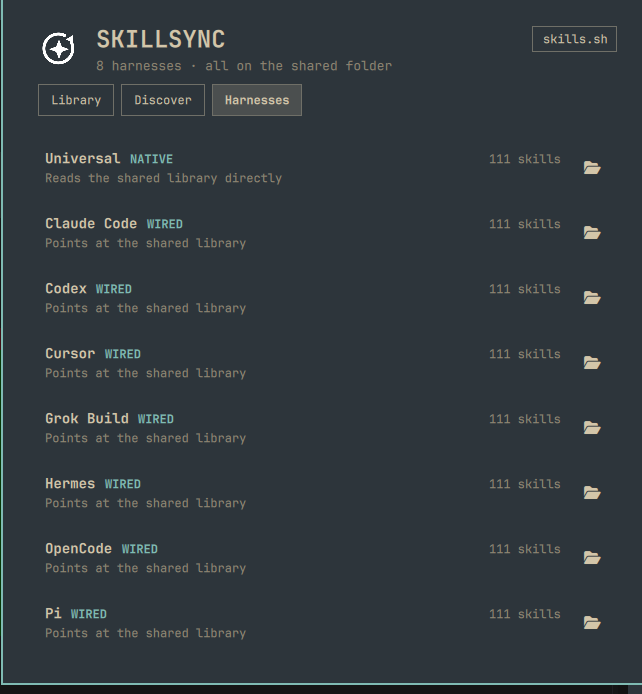

# SkillSync

<p align="center"></p>

An [Omarchy](https://omarchy.org) bar plugin for AI agent skills.

One shared library at `~/.agents/skills`, a [skills.sh](https://skills.sh) browser, and one-click wiring so Claude Code, Codex, Grok, Cursor, Hermes, and the rest all read the same folder.

**Plugins run unsandboxed inside `omarchy-shell` with your user permissions.** Read this repository before you enable it. Listing on the Omarchy marketplace is not a security review.

## Screenshots

<p align="center"></p>

<table>
  <tr>
    <td align="center"></td>
    <td align="center"></td>
    <td align="center"></td>
  </tr>
  <tr>
    <td align="center">Library</td>
    <td align="center">Discover</td>
    <td align="center">Harnesses</td>
  </tr>
</table>

## Install

```bash
omarchy plugin add https://github.com/tw3akercc/omarchy-skillsync.git --enable
```

Omarchy clones the repo to `~/.config/omarchy/plugins/jbicks.skills/`, warns that it is unsandboxed code, and offers to place the widget on the bar (default: right).

```bash
omarchy bar move jbicks.skills --section right
```

## Remove

```bash
omarchy plugin remove jbicks.skills
```

That uses the plugin id `jbicks.skills`. It does not delete `~/.agents/skills` or unwind harness symlinks you already created.

## What it does

- **Library** — skills in `~/.agents/skills`. Installs land here. Removing a skill from the library removes it for every wired harness.
- **Discover** — the skills.sh leaderboard, plus search. Official skills get a verified badge.
- **Harnesses** — each coding agent detected on the machine. **Use shared library** (after a confirmation) moves that harness's unique skills into the shared folder, renames the old directory to `skills.bak-skillkit-<timestamp>`, and replaces it with a symlink to `~/.agents/skills`.

Most harnesses cannot be configured to read `~/.agents/skills` themselves. Wiring is a directory-level symlink, not a per-skill copy. SkillSync never writes sudoers, systemd units, or other system configuration.

## Dependencies

| Dependency | Required for | Notes |
| --- | --- | --- |
| Omarchy 4.x / Quickshell | everything | Host shell. No second Quickshell process is started. |
| Python 3 | everything | Standard library only (`pathlib`, `json`, `urllib`, `subprocess`). |
| `npx` (Node.js) | Discover → Install only | Runs `npx --yes skills add … --skills-dir ~/.agents/skills`. Library scan and harness wiring work without it. |
| Network to `https://skills.sh` | Discover / search | Not used for the local library. |

No `sudo`, `pkexec`, package-manager, or extra daemon is required.

## Use

Click the SkillSync mark on the bar.

| Key | Action |
| --- | --- |
| `/` | Focus search |
| `1` `2` `3` | Library / Discover / Harnesses |
| `r` | Refresh |
| `Esc` | Close |

```bash
omarchy-shell jbicks.skills toggle
omarchy-shell jbicks.skills refresh
```

## License

MIT. See [LICENSE](LICENSE).

## Tests

```bash
tests/run.sh
```
